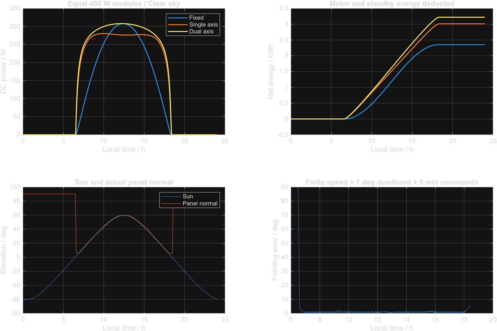

# Dual-axis solar tracker

This project compares a fixed solar panel with single-axis and dual-axis tracking over one day. The MATLAB dashboard shows the panel movement, power output and net energy after motor consumption. A separate Simulink model checks the same controller and PV calculation.

The weather comes from simple, repeatable scenarios. That lets you compare the three arrangements under identical conditions. The project is simulation-only; its results are not measurements from an installed tracker.

## Running the project

Download the repository as a ZIP and extract it. In MATLAB, set the extracted project folder as the Current Folder, then enter:

```matlab
SolarTrackerLab
```

The dashboard and numerical model need base MATLAB. The Simulink model and `verify_simulink` also need Simulink. The project was developed and tested with MATLAB R2026b.

Choose a location, date and weather condition, then click **Run Experiment**. The time slider moves through the calculated day; **Play** advances ten simulation minutes at a time and **Pause** stops it. The cards at the top show the full day's net energy. The values beneath the panels show the selected time.

**Energy & Control** contains the power, cumulative energy, panel-angle and pointing-error plots. **Export CSV + plots** writes the current run to `results/`. It replaces the previous export, so copy that folder first if you want to keep several runs.

To inspect the block model, click **Open Simulink model** or run:

```matlab
tracker_build_simulink
open_system('SolarTrackerSystem')
```

For MATLAB Online, open the standard MATLAB Online page and work from one session tab. The app displays frames rendered by MATLAB, which avoids the blank axes encountered with browser-side rendering. The camera is fixed; the time slider and playback still update the panels.

## Example result

The saved example is a clear-sky day in Roorkee: 21 March 2026, with three equal 400 W modules.

| Arrangement | Net daily energy |
| --- | ---: |
| Fixed panel | 2.3524 kWh |
| Single-axis tracker | 3.0112 kWh |
| Dual-axis tracker | 3.2201 kWh |

Movement and standby use 0.00822 kWh in the dual-axis tracker. Its net gain over the fixed panel is 36.88% for this clear-sky example. The overcast run gives a negative gain: following the sun does not always collect enough extra energy to compensate for moving the panel.



## Checks and further experiments

```matlab
addpath tests
validate_tracker
run_study
verify_simulink
```

`validate_tracker` checks the solar geometry, power calculation, travel limits, motor energy and timestep sensitivity. `run_study` compares four dates with three weather conditions. `verify_simulink` runs the block model and compares its angles and power with the MATLAB calculation.

The study covers twelve example days. It is not an annual-yield estimate. Change the fixed tilt, command interval, deadband or slew rate and compare the results.

## Files

| File | Purpose |
| --- | --- |
| `SolarTrackerLab.m` | Dashboard, playback and exports |
| `tracker_defaults.m` | Starting parameters |
| `tracker_sun.m` | Solar position |
| `tracker_simulate.m` | Weather, tracking and daily energy |
| `tracker_actuate.m` | Axis movement and motor power |
| `tracker_power.m` | Irradiance, temperature and PV output |
| `tracker_build_simulink.m` | Builds `SolarTrackerSystem.slx` |
| `tracker_export.m` | Saves tables and parameters |
| `tests/validate_tracker.m` | Numerical checks |

[Model equations and assumptions](docs/MODEL.md) explain the calculation. [Validation notes](docs/VALIDATION.md) describe what was checked and what the results establish.

## References

- [NOAA solar-position equations](https://gml.noaa.gov/grad/solcalc/solareqns.PDF)
- [Sandia PVPMC: isotropic sky diffuse model](https://pvpmc.sandia.gov/modeling-guide/1-weather-design-inputs/plane-of-array-poa-irradiance/calculating-poa-irradiance/poa-sky-diffuse/isotropic-sky-diffuse-model/)
- [Haurwitz clear-sky model](https://pvlib-python.readthedocs.io/en/stable/reference/generated/pvlib.clearsky.haurwitz.html)
- [MathWorks: simulation apps](https://www.mathworks.com/help/simulink/ug/create-app-for-simulink-model.html)
- [Related solar-tracker project](https://github.com/kanak108/Dual-Axis-Solar-Tracker-Controller), which provided the topic reference and Roorkee coordinates. Its source and model files were not copied.
